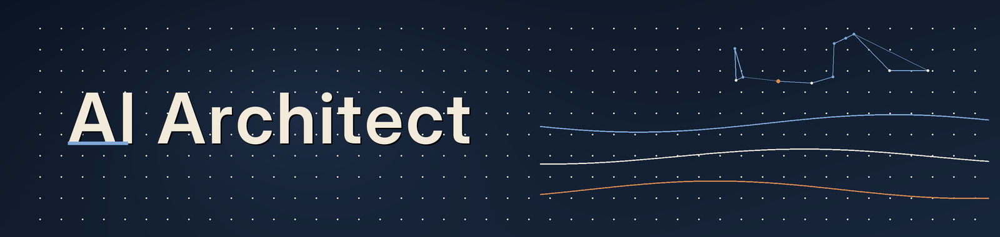

Office manager in the aerospace industry for four years, I have built technical expertise
in data science and artificial intelligence alongside my role.

Certified Data Scientist and AI Architect, building AI systems that are robust, scalable and governed by design.

---

| Step | Programme | Status | Content |
|:--|:--|:--|:--|
| 01 | **Essentials** | Certified 2025 | Data exploration and cleaning (EDA), hypothesis testing, regression, classification, Random Forest, SQL |
| 02 | **Fullstack** | Certified 2026 | Big Data, Deep Learning, Computer Vision, NLP, Large Language Models and RAG, MLOps, ETL pipelines |
| 03 | **Concepteur Développeur en Science des Données** | Certified 2026 RNCP35288 (Level 6 Master) | Six competency blocks, from data infrastructure to leading data projects |
| 04 | **Architecte en Intelligence Artificielle** | Certified 2026 RNCP38777 (Level 7) | Data and AI governance, data architecture, data pipelines, industrialisation and deployment of AI solutions |

---

My work is organised by training level, each project mapping to a competency block of the certification.

<table>
<thead>
<tr>
<th align="left">Block</th>
<th align="left">Project</th>
<th align="left">What it demonstrates</th>
</tr>
</thead>
<tbody>
<tr>
<td colspan="3"><a href="https://github.com/AichaFa/3-Projets_Lead"><strong>Lead - MLOps &amp; LLMOps</strong></a></td>
</tr>
<tr>
<td>Data and AI governance</td>
<td><a href="https://github.com/AichaFa/3-Projets_Lead/tree/main/1_Spotify_Data_Governance"><strong>Spotify Data Governance</strong></a></td>
<td>Maturity assessment, governance policy, RACI roles and a phased implementation roadmap</td>
</tr>
<tr>
<td>Data and compute infrastructure</td>
<td><a href="https://github.com/AichaFa/3-Projets_Lead/tree/main/2_Stripe_Business_Case"><strong>Stripe - integrated data architecture</strong></a></td>
<td>OLTP, OLAP and NoSQL architecture for a payment platform, with a real time change data capture pipeline (Debezium, Kafka, Airflow), fraud detection, product recommendation, security, compliance and Grafana supervision</td>
</tr>
<tr>
<td>Data pipelines</td>
<td><a href="https://github.com/AichaFa/3-Projets_Lead/tree/main/3_Automatic_Fraud_Detection"><strong>Automatic Fraud Detection</strong></a></td>
<td>Real time fraud detection pipeline: model training, deployment and monitoring, with an Airflow ETL ingesting a streaming payment API</td>
</tr>
<tr>
<td>Industrialisation and deployment</td>
<td><a href="https://github.com/AichaFa/projet_final_ACM"><strong>Medical Coherence Auditor</strong></a></td>
<td>Multimodal AI checking whether a radiology report is consistent with its chest X-ray, served end to end with a full MLOps chain: model registry, semantic drift monitoring and automated retraining</td>
</tr>
<tr>
<td colspan="3"><a href="https://github.com/AichaFa/2-Projets-Fullstack"><strong>Fullstack - Data Science &amp; Engineering</strong></a></td>
</tr>
<tr>
<td>Data infrastructure</td>
<td><a href="https://github.com/AichaFa/2-Projets-Fullstack/tree/main/1-Construire%20et%20g%C3%A9rer%20une%20infrastructure%20de%20donn%C3%A9es/Projet-Planifiez%20votre%20voyage%20avec%20Kayak"><strong>Kayak</strong></a></td>
<td>ETL pipeline feeding an AWS S3 data lake and PostgreSQL</td>
</tr>
<tr>
<td>Exploratory analysis</td>
<td><a href="https://github.com/AichaFa/2-Projets-Fullstack/tree/main/2-Analyse%20exploratoire%20des%20donn%C3%A9es/1-Speed%20Dating"><strong>Speed Dating</strong></a>, <a href="https://github.com/AichaFa/2-Projets-Fullstack/tree/main/2-Analyse%20exploratoire%20des%20donn%C3%A9es/2-Steam"><strong>Steam</strong></a></td>
<td>EDA on behavioural and gaming datasets</td>
</tr>
<tr>
<td>Machine learning</td>
<td><a href="https://github.com/AichaFa/2-Projets-Fullstack/tree/main/3-Apprentissage%20automatique/1-soldes%20Walmart"><strong>Walmart</strong></a>, <a href="https://github.com/AichaFa/2-Projets-Fullstack/tree/main/3-Apprentissage%20automatique/2-d%C3%A9fi%20du%20taux%20de%20conversion"><strong>Conversion rate challenge</strong></a>, <a href="https://github.com/AichaFa/2-Projets-Fullstack/tree/main/3-Apprentissage%20automatique/3-The%20North%20Face%20ecommerce"><strong>The North Face</strong></a></td>
<td>Regression, classification and unsupervised NLP</td>
</tr>
<tr>
<td>Deep learning</td>
<td><a href="https://github.com/AichaFa/2-Projets-Fullstack/tree/main/4-Apprentissage%20profond/D%C3%A9tecteur%20de%20spam%20AT%26T"><strong>AT&amp;T spam detector</strong></a></td>
<td>Neural network for text classification</td>
</tr>
<tr>
<td>Deployment</td>
<td><a href="https://github.com/AichaFa/2-Projets-Fullstack/tree/main/5-Deploiement/getaround_project"><strong>Getaround</strong></a></td>
<td>Pricing optimisation served with MLflow, FastAPI and Streamlit</td>
</tr>
<tr>
<td colspan="3"><a href="https://github.com/AichaFa/1-Projets_Essentials"><strong>Essentials</strong></a></td>
</tr>
<tr>
<td>Exploratory analysis and storytelling</td>
<td><a href="https://github.com/AichaFa/1-Projets_Essentials"><strong>Data scientist salaries 2025</strong></a></td>
<td>Analysis and data storytelling on the drivers of data science salaries in 2025</td>
</tr>
</tbody>
</table>

---

## What I learned at Jedha

My training at Jedha followed three successive cohorts, each building on the previous one,
from the foundations of data science to the industrialisation of AI systems in production.
The sections below summarise what each cohort covered. The technical stack of each cohort,
combining what I used in my projects and what I studied in class, is listed in the
collapsible panels.

**Essentials - Data Science foundations**

The entry point. I learned the fundamentals of data science and programming with Python and
SQL, exploratory data analysis and cleaning (EDA), statistical validation through hypothesis
testing, and the first machine learning algorithms (regression, classification, Random
Forest), together with data storytelling to turn an analysis into clear recommendations.

<strong>Essentials - stack & tools</strong>

 

**Languages & core**

**Data & compute**

**Visualisation**

**Machine learning**

**Fullstack - Data Science & Engineering**

The technical deepening. I learned to build and manage data infrastructure and ETL pipelines
(data lakes, cloud, scraping), to work with big data, and to train machine learning and deep
learning models across computer vision and natural language processing, up to large language
models and retrieval augmented generation. This cohort also introduced the first steps of
deployment and MLOps: exposing models through APIs, containerisation and experiment tracking.

<strong>Fullstack - stack & tools</strong>

 

**OS & shell**

**Data collection & scraping**

**ETL & orchestration**

**Databases & storage**

**Cloud**

**Big data**

**Machine learning**

**Deep learning & computer vision**

**Natural language processing**

**LLM & RAG**

**Visualisation**

**Deployment & MLOps**

**Lead - MLOps & LLMOps**

The expertise stage, focused on production and leadership. I learned data and AI governance
(governance frameworks, RACI, compliance), the design of complex data architectures (OLTP,
OLAP and NoSQL, real time change data capture pipelines) and the full industrialisation of
models through an MLOps and LLMOps chain: model registry, monitoring and drift detection,
automated retraining, together with distributed computing and reinforcement learning for
operational research.

<strong>Lead - stack & tools</strong>

 

**Architecture & databases**

**Real-time & pipelines**

**Containers & orchestration**

**Distributed computing & RL**

**Machine learning & deep learning**

**LLMOps**

**MLOps & quality**

**Supervision**

**Cloud**

**Platform**

---

---

> *"The goal of data is not to answer questions, but to help you ask better ones."*
